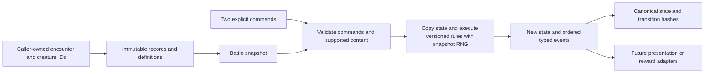

# Gameplay core Phase 1 architecture

## Boundaries and versioning

The authoritative starting policy is **HGSS Generation IV**, implemented as a declared subset, `hgss-gen4-subset-1.0.0`. The subset label is intentional: unsupported abilities, move effects, items and battle modes cannot be inferred to work. Unknown ruleset strings are rejected. The current catalog is `hgss-facts-pilot-1`; future catalog or mechanics changes must receive a new version and reviewed golden fixtures.

Core is a C# 9 / .NET Standard 2.1 assembly using only the standard library. Proof is an executable scripted client; Tests is a separate xUnit project. Neither host is a production dependency. No UI, camera, scene, Unity GameObject, database provider, ROM loader, world map, filesystem save path or wall clock belongs to the gameplay core.

The pilot catalog is currently a small in-assembly gate. The integration design replaces this with an immutable, injected catalog registry keyed by version and content hash; it does not add runtime SQL or let the Unity importer rewrite species facts. The temporary `fixture-` namespace must be removed or disabled at a production ingress boundary.

## Identity, definitions and state ownership

`PokemonRecord.IndividualId` is a nonempty caller-supplied GUID. It is independent of species, form, level, slot, encounter and RNG seed. `BattleState.EncounterId` is a separate nonempty caller-supplied GUID. A new encounter receives a new identity even when its opponent resembles an earlier one; replay preserves the original identity. Duplicate individuals across both battle parties are rejected.

SpeciesDefinition is immutable: stable ID, data version, six base stats, one or two Gen IV types, and the one-HP exception. Known pilot facts cannot be overridden under the same ID, including the Gen IV Tackle definition. Within a battle, conflicting definitions sharing one ID are rejected. No permanent enhancement or geographic difficulty factor edits these definitions.

PokemonRecord holds immutable level, IVs, EVs, nature, ability and a defensively copied move list. SixStats copies all exposed arrays; it has no mutation API. Immutable definitions may safely be shared between records. `WithSpeciesAndLevel` produces a new record with the same individual identity and unchanged IVs/EVs/moves/ability/nature; it is an update primitive, **not** a validated evolution or reset service.

BattlePokemon holds only encounter state: current HP, PP, major status and seven stages. Arrays are copied on input and exposed through read-only wrappers. Setters are internal. BattleState copies every BattlePokemon on construction and DeepCopy, retains party order/active slots, and derives its outcome from remaining HP. Transitions never mutate the input snapshot. Changing a copied array cannot mutate a record or another battle branch.

The persistent record is deliberately incomplete for a finished Pokémon: gender, personality value, shininess, friendship, experience, held items, form metadata, original trainer and evolution history need a later versioned persistence DTO. A GUID does not replace all of the cartridge personality value's phenotypic roles. These omissions are not hidden behind a claimed full save schema.

## Implemented arithmetic and generation

Integer arithmetic floors at each documented division for nonnegative operands. Intermediates use checked Int64, followed by checked conversion to Int32. Overflow rejects the operation instead of wrapping or silently clipping. The PRNG's bit operations alone intentionally use UInt32 wraparound. No floating-point arithmetic enters stats, accuracy, damage or ordering.

IVs are 0–31. Gen IV EVs are 0–255 per stat and at most 510 total; the remainder is retained, and floor(EV/4) enters stats. Levels are 1–100. All 25 natures use Gen IV ordering, including neutral natures and floor-rounded 110%/90% modifiers. HP is independent of nature, with the explicit one-HP exception.

For an ordinary species, HP is `floor((2B + IV + floor(EV/4)) × L / 100) + L + 10`. Other stats add 5 instead of L+10, then apply and floor the nature multiplier. Species facts remain unchanged throughout.

`creature-factory-1.0.0` uses an explicit seed to draw HP/Attack/Defense/SpecialAttack/SpecialDefense/Speed IVs and then a nature; EVs start at zero. Ability, moves and individual identity are explicit caller inputs. Generation and battle use separate caller-selected streams. This is reproducible project generation, not a reproduction of DS PID generation, DS seed advancement or save compatibility.

Randomness is `xorshift32-rejection-1`: nonzero UInt32 state, shifts 13/17/5, plus a checked raw-draw counter. A zero seed is rejected. The nonzero output domain is shifted to [0, 2^32−2]; rejection removes incomplete buckets before bounded reduction. This avoids modulo bias over the full output domain; it is not a claim that adjacent outputs are independent. The algorithm is small and inspectable but has known linear/low-bit quality limitations and is not a cryptographic generator. Review the long-term PRNG before approving production replay formats. Changing it requires a new algorithm version.

## Turn execution and events

ResolveTurn accepts one command per side. Both commands are validated before cloning/execution. A turn requires an ongoing battle with no pending replacements. Voluntary switching has priority 6, followed by the supported move priority, then start-of-turn effective Speed, then a seeded tie-break. Mid-turn paralysis does not reorder already selected actions.

Switching redirects subsequent attacks to the incoming active individual, resets stages, and preserves each individual's HP/status/PP. Benched burn does not tick. When an active individual faints and a reserve remains, the engine returns ReplacementRequired and accepts an explicit ReplaceFainted transition. It consumes neither an extra turn nor RNG. Both pending sides must choose replacements before another turn. The prototype uses explicit set-style replacement; the cartridge's optional Shift prompt is outside scope.

An attempted move checks full paralysis before spending PP. A normal attempt spends one PP even if it misses or has no effect. Zero-PP actions reject; Struggle is not silently substituted. Accuracy zero means bypass the accuracy check. Otherwise the quantized HGSS accuracy/evasion table and a [0,99] roll determine a hit. This table is not replaced by exact thirds: 75% at +1 is 99%.

Successful damaging moves use the physical/special stat split, stage modifiers, Gen IV 2× critical hits, one of sixteen 85–100 damage rolls, 1.5× STAB and the 17-type Gen IV chart. Critical hits ignore negative attacking and positive defending stages, but retain beneficial attacking/negative defending stages and the burn penalty. Burn halves the appropriate pre-+2 physical subtotal. The multiplier is applied before random, STAB and type modifiers. Matchups apply in the pinned runtime chart's entry order; the nonzero-division minimum is preserved. Immune targets take zero, not one.

Supported statuses are burn and paralysis. Burn is prevented on Fire types, reduces physical damage, and deals floor(maxHP/8), minimum one, to an active survivor at end of turn. Paralysis quarters Speed (including a possible zero after truncation) and has a 1/4 inability chance. Electric types can be paralyzed under Gen IV rules; Electric Thunder Wave fails against Ground types. Existing major status cannot be overwritten. Ember's 10% secondary burn is supported. Growl lowers Attack one stage, bounded at −6. Starter abilities Overgrow/Blaze/Torrent boost matching base power at the one-third-HP threshold. Run Away and Gen IV Sturdy have no applicable effect among the supported actions: escape and OHKO moves are absent; **modern Sturdy survival is not enabled**.

HP damage clamps to remaining HP and emits Fainted exactly at the transition. An actor knocked out before its action does not act or spend PP. A terminal knockout ends before residual ticks. Supported burn residuals run in effective-Speed order; ordering can determine a terminal outcome. No fabricated draw, terrain interaction or reward is added to make a fixture end favorably.

Events are immutable typed records in result-list order, with turn, actor/target GUIDs, detail, amount and roll. RandomRoll records purpose, bound and result. Damage records actual applied HP loss and its 85–100 roll; formula diagnostics are also included in the proof. Events report gameplay facts, not animation durations. A future reward adapter needs explicit defeat receipts rather than treating every UI replay of Fainted as a fresh reward.

## Replay and integrity

The canonical state format has a version tag and length-prefixed invariant strings. It includes encounter ID, ruleset, RNG algorithm/state/draw count, all definition contents, individual records, party/active order, PP, stages, HP and status. Derived stats/outcome are recomputed. Ordered events have a separate tag. Transition hashes cover before state, both commands, after state and ordered events. SHA-256 is an integrity identifier, not authentication.

Replay requires the exact ruleset/catalog/algorithm implementation plus initial snapshot and command sequence. The proof records canonical initial/final state and per-transition hashes; golden expected outcomes/hashes are frozen separately. Checkpoint tests reconstruct snapshots including RNG state/counter and reproduce the next transition. **There is no general canonical decoder, durable save repository, migration implementation or crash recovery yet.** The JSON host trace is evidence, not an approved save format.

The random-call schedule is part of this version: ordering tie if required; full-paralysis check for eligible actors; accuracy unless bypassed; critical and damage range for nonimmune damaging hits; eligible secondary burn; residual tie if burn processing needs ordering. This is not the original cartridge's RNG-call schedule or biased modulo reduction, and no seed-level cartridge equivalence is claimed.

## Planned roguelite contracts

These are designs only, represented by interfaces under `Roguelite.Gameplay.Planned`. DTO sketches are not production serialization schemas and no gameplay modifier service exists yet.

| Contract | Proposed invariant and calculation | Review decision still needed |
|---|---|---|
| ICreatureProgression / EnhancementGrant | Per-individual grant ledger with stable grant ID, stat, origin species/base value and policy version; retained through evolution/reset | Additional fields for fractional inherited bonuses and grant provenance |
| IEnhancedBaseStatPolicy | Proposed +5% grants add percentage points: `effectiveBase = floor(currentBase × (100+5g)/100)` per stat; retain fractional entitlement in the ledger until the stated rounding boundary; never mutate catalog facts | Confirm additive vs compounded stacking, caps and handling of the one-HP exception |
| Evolution history / bonus policy | Preserve GUID, grant history and evolution lineage; inherited bonuses are resolved by an explicit versioned policy | Whether inheritance means percentage grants applied to evolved base stats, carried flat earned deltas, and/or a separate evolution bonus; no amount has been invented |
| IRunResetService | Produce a validated atomic plan setting eligible individuals to level 5 while preserving evolved species/form, moves, ability, nature, IVs/EVs, enhancements, identity and party/PC references | XP reset threshold, HP/status/PP/held-item policy, and any exceptions |
| Protected PC boxes | Proposed protected boxes and their individual snapshots are excluded from reset, with stable box/slot IDs and preserved contents; protection is domain state, not a UI flag | Confirm whether protection excludes every reset mutation or only level changes; concurrency/transaction policy |
| IDefeatRewardPolicy / IRewardLedger | Rewards restricted to 1/10/30 per opposing individual defeated; a receipt keys encounter ID + individual ID + defeat ordinal. Duplicate delivery of one defeat is idempotent; another encounter can reward again | Proposed wild/trainer/boss mapping is not approved; eligibility after residual/self-KO and boss classification |
| IZoneDifficultyPolicy | Proposed factor `(115/100)^tier`, first tier zero, applied to an opponent snapshot before ordinary stat calculation; no repeated integer rounding at each zone and no catalog edits | Exact zone-to-tier map, maximum tier and final combined enhancement/scaling rounding boundary |
| ISaveRepository | Atomic versioned transaction persists roster, protected boxes, enhancements, reset plan and reward ledger together; stable IDs and integrity hashes, no BinaryFormatter | DTO schema/migrations, rollback and crash-recovery protocol |

Higher effective base stats may exceed the source catalog's byte bounds. A future calculator must accept a separate validated effective-base input and checked rational arithmetic, rather than constructing an altered SpeciesDefinition. Use bounded tiers/grants with checked operations, or a reviewed BigInteger rational policy; never wrap, silently saturate, or accumulate floating-point drift. None of these modifiers changes current Gen IV battle results.

## Modern extensions remain explicit proposals

Later species/forms require a separately versioned catalog, learnsets, evolution and save mappings. Fairy typing and the modern Steel chart, 1.5× critical hits, modern critical rates, Electric paralysis immunity, half-Speed paralysis, modern Sturdy and 1/16 burn residuals are **not enabled**. If selected later, they belong to an explicit extension/ruleset profile with new conformance tests. HGSS world identifiers remain independent of any species/location database's identifiers.
