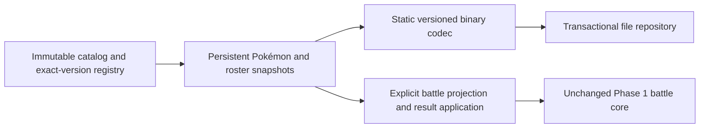

# Phase 2 architecture changes

## Assembly boundaries

The accepted Phase 1 assembly remains byte-identical. New assemblies sit beside it under Phase2:

Domain depends on the project-owned core's immutable value types and validated stat formula. Persistence depends on Domain. Neither references UnityEngine, SQLite, reflection serializers or a third-party gameplay framework. Proof, fixtures, tests and compatibility harnesses remain outside the production assemblies.

The old Phase 1 PokemonRecord remains the bounded battle/prototype record. **PersistentPokemon is now the durable individual domain model.** There is no automatic migration from an old battle projection: it lacks PID, trainer, experience and other information that cannot safely be guessed.

## Identity and immutability

Individual GUIDs are explicit caller-owned identities. They survive party/PC transfer, evolution, form changes, result application and save/reload. Save profile, handler, commit, box, location slot, move slot and evolution event also have stable identities. A creature must occupy exactly one party/PC location. Duplicate placements, orphaned creatures, dangling references, identity collisions and foreign handler ownership reject during snapshot construction.

Mutable CreatureData/SaveData objects are **edit/transport drafts**, never authoritative live records. Constructors copy them before validation; published PersistentPokemon and SaveSnapshot own their complete data. Export returns another deep copy, including IV/EV arrays, move entries, trainer data, ribbons, contest data, native metadata, evolution history and extension payloads. Strings and immutable catalog definitions can be shared safely. No published object's state can be changed by editing an exported draft.

## Persistent creature profile

| Group | Retained data and validation |
|---|---|
| Identity and species | Individual GUID; species/form identifiers; exact catalog pin at the roster boundary; current handler GUID |
| Personality | UInt32 personality, PID-derived Gen IV nature and gender; explicit ability slot and resolved ability ID; shiny status derived from OT/PID XOR < 8 |
| Stats/progression | Six IVs 0–31; six EVs 0–255, total ≤510; level 1–100; coherent experience under the species' named growth profile; current HP bounded by unchanged HGSS stats |
| Moves | Ordered stable move-slot IDs, move IDs, current PP and PP Ups 0–3; maximum PP uses floor(base PP × (5+Ups)/5) |
| Held item and friendship | Explicit item reference, holdability validation and friendship byte |
| Trainer and labels | Original trainer UInt32 ID (public/secret halves), name, gender and language; creature language; nickname and nickname flag |
| Condition/egg | Healthy, sleep, poison, burn, freeze, paralysis and toxic storage; sleep counter; egg flag and remaining cycles. Battle support remains narrower |
| Origin | Origin game code, met/egg locations and dates, met level, ball reference, fateful encounter, met terrain; legacy DP location/ball codes retained separately |
| HGSS attributes | Pokérus strain/days, markings, six contest/sheen bytes, ribbon bits, six Shiny Leaf/crown bits, signed mood, capsule ID |
| Native metadata | Optional 56-byte mail and 24-byte seal metadata blocks, uninterpreted and copied losslessly; synthetic fixtures only, no original letter content or graphics |
| History/extensions | Validated evolution-event chain; keyed/schema-tagged bounded opaque extension documents retained exactly |

Gender and nature must agree with the selected HGSS species threshold and PID. Ability must match an explicit form ability slot; the slot is retained independently rather than reconstructing it destructively from PID on load. New factory creation selects PID parity, while stored explicit slots can preserve relevant legacy distinctions. A raw absent second ability remains `none` in the catalog; its resolution to the first slot is an explicit operation. Individual records never acquire a synthetic “no ability” fallback.

Names use strict UTF-8 with bounded lengths and no normalization or truncation. This is a project save representation, not an export to the original DS font/character encoding. Dates can be explicitly absent; otherwise the HGSS year range and calendar date are validated. Mail/seal interpretation, letter rendering, hatching and Pokéathlon behavior are not implemented by retaining their input metadata.

This profile is designed for valid supported HGSS-domain data, not every glitch state or a lossless native PK4/DS save image. Unknown source/native material can be retained under a versioned extension only through an explicit future importer. No native save importer was added.

## Party and PC

The HGSS storage profile has six stable party slots and one to eighteen boxes, each containing thirty stable slots. An empty slot is explicit. IDs persist even when the occupant changes. Transfer into an occupied slot requires an explicit swap request; a source cannot be empty. Box/slot order and labels survive serialization.

ProtectionPolicyReference is an uninterpreted reservation, not a final “protected” flag. Empty means no policy binding is present. Operations involving a nonempty binding fail with a policy-resolver-required error, so an unknown future rule is not silently ignored. Save/reload retains the binding. No protection duration, exception, automatic lock or reset policy has been invented.

The profile may temporarily have an empty party during domain editing; battle entry still requires a valid supported party. Transfer is a raw location operation and preserves creature HP/status/PP; it is not a complete cartridge PC-deposit action. PC auto-healing, last-capable-party-member restrictions, native mail handling, trading, release policies and UI behavior remain future application rules.

## Catalog architecture

Catalog definitions are immutable, sorted canonically and versioned separately from save schema and battle rules. Catalog schema is `catalog-1.0.0`; the bounded data package is `hgss-domain-pilot` version `2.0.0`. A SHA-256 content hash covers identity/version, ruleset, every species/form/stat/ability-slot/growth/friendship/evolution link, move descriptor, battle-support mapping and item flag.

The current package contains seven species, eight form entries, eleven moves, nine ability/sentinel entries and four items. This is intentionally not the full HGSS data set. Deoxys forms, Toxic, Pressure, Guts and Magnet Pull demonstrate **storable data without unimplemented battle execution**. The five Phase 1 species and ten supported moves retain their exact accepted definitions. Form IDs also retain the source form index; national dex and source indices are not inferred from display names.

Validation rejects duplicate IDs, aliased national-dex species, duplicate source form indices, missing references, malformed forms, unsupported adapters and cyclic evolution graphs. Registry identity is catalog ID + version; rebinding one version is forbidden. Resolve requires the requested version and exact hash. There is no “latest available” fallback. Collection order/culture changes do not alter canonical content.

SaveSnapshot binds exactly to one available catalog and ruleset. Schema migration does **not** authorize catalog rebinding. Catalog-content migration requires a future reviewed mapping/transaction design; mismatches currently fail explicitly. Full external catalog-package ingestion, provenance attestation and complete move/learnset legality are not claimed here.

## Evolution and battle boundary

RecordEvolution applies an already externally authorized catalog-linked transition, preserving individual identity, traits, moves/PP, original trainer data and extension bytes, and recording an event. It retains damage through the maximum-HP change. It does not evaluate evolution eligibility, Everstone blocking, triggers, friendship thresholds, new moves or roguelite inheritance bonuses. Those are Phase 3/application concerns; an evidence ID is descriptive, not proof that the core implemented the trigger.

BattleProjection performs an explicit supported-subset check. Eggs, held items, unsupported statuses, PP Ups, unsupported abilities, forms/species or moves reject rather than being approximated. Stats-only validation uses the unchanged Phase 1 stat calculator; its neutral temporary ability/move inputs have no role in arithmetic and are never treated as playable creature fallbacks.

ApplyResult accepts only the same individual and unchanged species, level, nature, IVs, EVs, ability and move definitions. It copies back only supported durable HP, PP and condition results. Volatile stages remain battle state. The source roster is unchanged; committing the resulting roster still requires revision comparison. There is no durable mid-battle checkpoint or automatic award/XP application.

## Save transaction foundation

SaveSnapshot is a complete roster transaction unit: profile/player, catalog pin, revision/commit ID, individuals, party, PC and extension documents. PrepareCommit produces a new revision. Repository writes require the caller's expected revision; the same current commit/payload can be retried idempotently, while conflicts reject. This is a persistence primitive, not a completed Poké-Point ledger.

[SAVE-FORMAT.md](SAVE-FORMAT.md) defines encoding, corruption classification, migration and publication. Only explicitly committed primary/backup generations are load candidates; temporary files are never promoted on read. Recovery is explicit and preserves corrupt bytes in a non-overwriting quarantine. Publication errors require reload and commit-ID reconciliation, not a blind new transaction.

## Roguelite extension boundaries and review decisions

Enhancements are independent versioned extension documents, never edits to species definitions, IVs or EVs. Their bytes survive transfer/evolution/save without being interpreted as stat bonuses. Root extensions similarly reserve Poké-Point transaction/reset data. Future typed grant/ledger schemas must replace opaque data through reviewed migrations.

Unresolved policies remain unchanged: additive versus compounded +5% grants, fractional rounding and caps, evolution inheritance, one-HP exceptions, reset HP/status/PP/XP/item behavior, protected-box semantics, 1/10/30 reward classification and geographic tier mapping/compounding boundaries. No arithmetic or reset behavior has been finalized or applied.

A future roguelite ruleset must explicitly extend effective-stat validation: the current profile validates current HP against vanilla HGSS stats and does not treat opaque grant bytes as active modifiers. Reward receipts need durable unique defeat identities and transaction semantics; repository idempotence of the current commit is not a substitute for a complete reward history. New encounters must remain rewardable while repeat delivery of one defeat is deduplicated.
